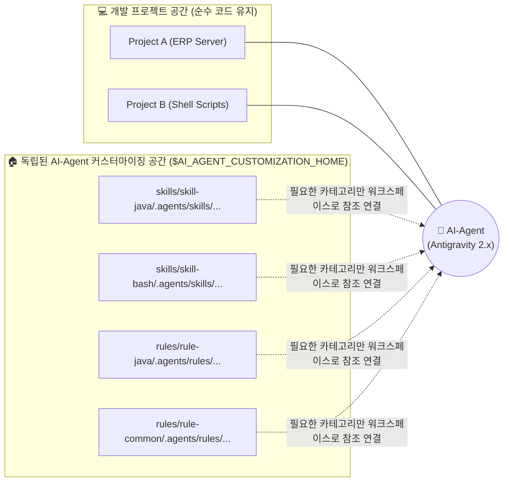

# 🎯 `acs-cli` 도입 목적 및 사용 권고 (Purpose & Recommendation)

> **"개발 프로젝트 공간은 순수하게 코드와 비즈니스 로직을 위해 남겨두고, AI-Agent를 위한 지식 자산(`Skill` / `Rule`)은 독립된 전용 공간에서 체계적으로 관리하십시오."**

`acs-cli`(**AI-Agent Customization System CLI**)는 AI 코딩 에이전트(Google Antigravity 등)가 사용하는 **스킬(`Skill`)**과 **규칙(`Rule`)**을 개별 개발 프로젝트 디렉토리 내부에 직접 포함시키지 않고, **독립적인 중앙 관리 공간(`${AI_AGENT_CUSTOMIZATION_HOME}`)**에 생성·관리·참조할 수 있도록 지원하는 전용 도구입니다.

---

## 1. 배경: 왜 개발 프로젝트 공간과 분리해야 하는가?

AI 에이전트는 기본적으로 워크스페이스 루트의 `.agents/skills/`나 `.agents/rules/` 경로를 탐색하여 스킬과 규칙을 로딩합니다. 그러나 실제 실무 개발 환경에서 각 개발 프로젝트 폴더 내부에 직접 `.agents/` 디렉토리를 생성하여 관리할 경우 다음과 같은 구조적 문제가 발생합니다.

### ❌ 1) 개발 프로젝트 저장소(Git)의 오염
* 애플리케이션 소스코드만 존재해야 할 프로젝트 저장소에 AI 에이전트 전용 프롬프트, 개인화된 규칙, 보조 스크립트가 혼재됩니다.
* 협업 시 팀원 간 에이전트 설정 충돌을 막기 위해 매번 `.gitignore`나 `.git/info/exclude`를 수정해야 하는 불필요한 형상 관리 비용이 발생합니다.

### ❌ 2) 다중 프로젝트 간 스킬/규칙의 파편화와 중복 복사
* 동일한 기술 표준(예: `Java Javadoc 작성 규격`, `Bash 스크립트 표준`, ` 사내 보안 가이드`)을 여러 마이크로서비스나 다중 저장소에서 공통으로 사용해야 할 때, 각 프로젝트마다 `.agents/` 파일을 복사해 넣으면 **수정 사항이 발생할 때마다 모든 프로젝트를 일일이 찾아다니며 갱신**해야 합니다.

### ❌ 3) 에이전트 로딩 충돌 및 워크스페이스 식별성 저하
* 여러 프로젝트를 동시에 열어 작업할 때 어떤 워크스페이스가 실제 개발 리소스(코드)이고 어떤 것이 에이전트 설정인지 한눈에 식별하기 어렵습니다.
* 특히 Antigravity 2.x 환경에서는 서로 다른 폴더에 동일한 이름의 스킬이 존재하면 **단 1개의 스킬만 로딩되고 나머지는 무시(Override)**되거나, 규칙 파일에 적절한 Frontmatter(`trigger: always_on`)가 누락되면 에이전트가 규칙을 전혀 읽지 못하는 휴먼 에러가 발생하기 쉽습니다.

---

## 2. `acs-cli`가 제공하는 핵심 해결책

`acs-cli`는 위 문제들을 해결하기 위해 **관심사의 분리(Separation of Concerns)**와 **단일 진실 공급원(Single Source of Truth)** 원칙을 기반으로 설계되었습니다.



### ✅ 1) 개발 프로젝트 무결성 보존 (Zero-Footprint)
* 개발 프로젝트 디렉토리에는 단 하나의 `.agents/` 폴더나 마크다운 규칙 파일도 생성하지 않습니다.
* 모든 `Skill`과 `Rule`은 `${AI_AGENT_CUSTOMIZATION_HOME}` 하위의 독립된 디렉토리에서만 생성되고 관리되므로, 개발 저장소의 Git 상태를 100% 깨끗하게 유지할 수 있습니다.

### ✅ 2) 명확한 워크스페이스 식별 (`skill-<category>`, `rule-<category>`)
* `acs-cli`로 카테고리를 생성하면 디스크 상에 `skill-<카테고리>`, `rule-<카테고리>` 이름으로 디렉토리가 구성됩니다.
* AI 에이전트 앱(Antigravity App 2.x 등)에 폴더를 추가했을 때 일반 개발 리소스(`java/`)와 에이전트 커스터마이징 폴더(`skill-java/`, `rule-java/`)를 즉각 구분할 수 있습니다.
* 반면 CLI 명령어와 탭(`<TAB>`) 자동완성에서는 접두사를 제외한 논리 카테고리명(`java`)만 입력하면 되므로 조작 편의성을 해치지 않습니다.

### ✅ 3) 심볼릭 링크 기반의 유연한 조합 및 재사용 (`add`)
* 이미 생성된 스킬이나 규칙을 다른 카테고리에 포함시켜야 할 때 파일을 복사하지 않고 `acs-cli add` 명령어를 통해 **심볼릭 링크(Symbolic Link)**로 참조합니다.
* 원본 스킬이나 규칙 파일을 한 번만 수정하면, 이를 참조하는 모든 카테고리에 변경 사항이 즉시 반영됩니다.

### ✅ 4) 에이전트 호환성 및 무결성 자동 보장
* **전역 스킬 이름 중복 차단**: 스킬 생성 시 전체 카테고리를 전수 검사하여 동일한 스킬 이름(`--name` 및 `SKILL.md` Frontmatter)이 이미 사용 중이면 생성을 즉시 차단합니다.
* **규칙 자동 로딩 보장**: 규칙 생성 시 Antigravity 2.x에서 누락 없이 즉시 활성화되도록 `trigger: always_on` YAML Frontmatter가 탑재된 표준 템플릿을 자동 생성합니다.
* **빈 카테고리 자동 정리**: 스킬이나 규칙을 삭제한 뒤 해당 카테고리에 남은 항목이 없으면 빈 껍데기 카테고리 디렉토리까지 깔끔하게 자동 정리합니다.

---

## 3. 기존 방식 vs `acs-cli` 사용 방식 비교

| 비교 항목 | 프로젝트 내 직접 관리 방식 (기존) | `acs-cli` 독립 공간 관리 방식 (권고) |
| :--- | :--- | :--- |
| **저장 위치** | 각 개발 프로젝트 루트 내부 (`<project>/.agents/`) | 독립된 전용 공간 (`${AI_AGENT_CUSTOMIZATION_HOME}`) |
| **Git 저장소 영향** | 프로젝트 Git 상태에 노출됨 (`.gitignore` 관리 필요) | **개발 프로젝트와 완전 격리 (영향 없음)** |
| **다중 프로젝트 재사용** | 프로젝트마다 파일 복사 (수정 시 버전 불일치 발생) | **중앙 관리 및 심볼릭 링크(`add`) 참조로 단일 원본 유지** |
| **워크스페이스 식별성** | 개발 폴더와 구분이 어려움 | **`skill-<cat>`, `rule-<cat>` 접두사로 즉각 식별** |
| **스킬/규칙 무결성 검증** | 수동 작성 (이름 중복 충돌·Frontmatter 누락 위험) | **전역 중복 검사 및 표준 템플릿 자동 생성** |
| **조작 및 탐색 편의성** | 수동으로 깊은 경로(`mkdir -p`, `ln -s`, `rm`) 제어 | **직관적인 CLI 명령어 및 단계별 `<TAB>` 자동완성 제공** |

---

## 4. 권장 운영 가이드

1. **전용 루트 공간 지정**:
   `~/.bashrc` 또는 `~/.bash_profile`에 AI-Agent 커스터마이징 전용 루트 환경변수를 선언합니다.
   ```bash
   export AI_AGENT_CUSTOMIZATION_HOME="$HOME/dev/ai-agents"
   ```
2. **도메인/역할별 카테고리 생성 및 관리**:
   특정 프로젝트에 종속시키지 않고 기술 스택이나 역할 단위(예: `java`, `bash`, `devops`, `security`)로 카테고리를 나누어 스킬과 규칙을 생성합니다.
   ```bash
   acs-cli create skill --category bash --name bash-scripts
   acs-cli create rule  --category java --name javadoc-spec
   ```
3. **복합 작업 환경을 위한 참조 조합 (`add`)**:
   특정 업무에서 여러 도메인의 스킬/규칙 묶음이 필요하다면, 파일을 복제하지 말고 `add` 명령어로 심볼릭 링크 카테고리를 구성합니다.
   ```bash
   acs-cli add skill --category fullstack --name bash/bash-scripts
   ```
4. **AI-Agent 워크스페이스에 마운트**:
   작업 중인 개발 프로젝트와 함께 `${AI_AGENT_CUSTOMIZATION_HOME}/skills/skill-<카테고리>` 또는 `${AI_AGENT_CUSTOMIZATION_HOME}/rules/rule-<카테고리>` 폴더를 에이전트 워크스페이스에 추가하여 깔끔하고 일관된 AI 페어 프로그래밍 환경을 유지합니다.
