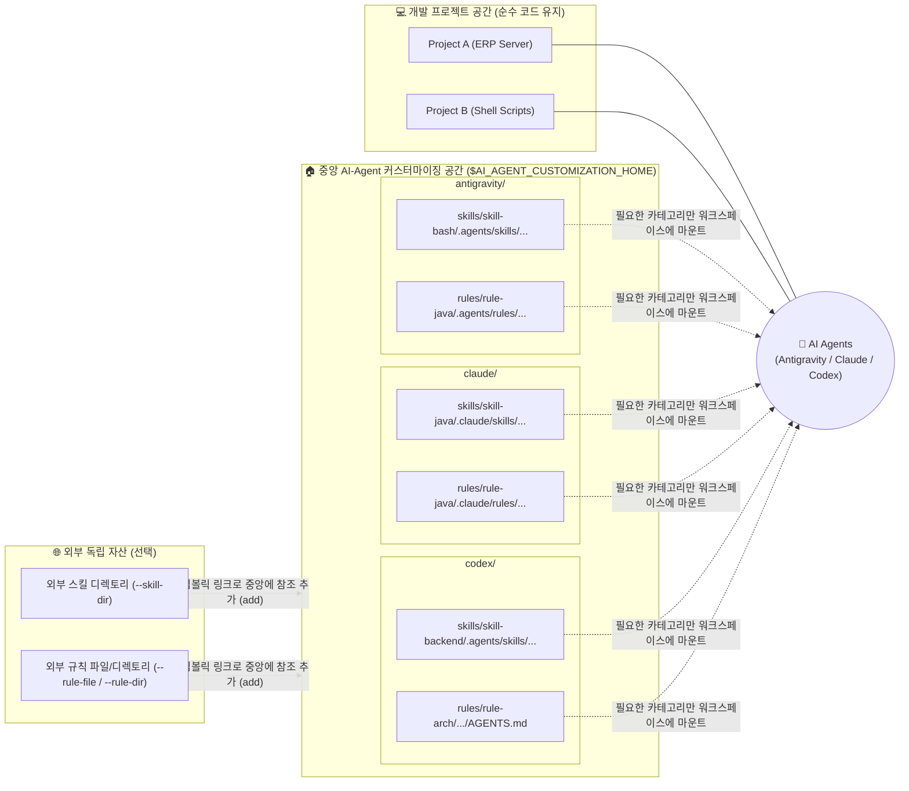

# 🎯 `asr-cli` 도입 목적 및 사용 권고 (Purpose & Recommendation)

> **"개발 프로젝트 공간은 순수하게 코드와 비즈니스 로직을 위해 남겨두고, 다중 AI-Agent(`Antigravity`, `Claude Code`, `OpenAI Codex`)를 위한 지식 자산(`Skill` / `Rule`)은 독립된 전용 공간에서 체계적으로 관리하십시오."**

`asr-cli`(**AI-Agent Customization System CLI**)는 다양한 AI 코딩 에이전트가 사용하는 **스킬(`Skill`)**과 **규칙(`Rule`)**을 개별 개발 프로젝트 디렉토리 내부에 직접 포함시키지 않고, **독립적인 중앙 관리 공간(`${AI_AGENT_CUSTOMIZATION_HOME}`)**에 생성·관리·편집·참조할 수 있도록 지원하는 전용 통합 관리 도구입니다.

---

## 1. 배경: 왜 개발 프로젝트 공간과 분리해야 하는가?

AI 에이전트는 기본적으로 워크스페이스 루트의 설정 디렉토리(`.agents/`, `.claude/` 등)를 탐색하여 스킬과 규칙을 로딩합니다. 그러나 실제 실무 개발 환경에서 각 개발 프로젝트 폴더 내부에 직접 에이전트 설정 디렉토리를 생성하여 관리할 경우 다음과 같은 구조적 문제가 발생합니다.

### ❌ 1) 개발 프로젝트 저장소(Git)의 오염
* 애플리케이션 소스코드만 존재해야 할 프로젝트 저장소에 AI 에이전트 전용 프롬프트, 개인화된 규칙, 보조 스크립트가 혼재됩니다.
* 협업 시 팀원 간 에이전트 설정 충돌을 막기 위해 매번 `.gitignore`나 `.git/info/exclude`를 수정해야 하는 불필요한 형상 관리 비용이 발생합니다.

### ❌ 2) 다중 프로젝트 간 스킬/규칙의 파편화와 중복 복사
* 동일한 기술 표준(예: `Java Javadoc 작성 규격`, `Bash 스크립트 표준`, `사내 보안 가이드`)을 여러 마이크로서비스나 다중 저장소에서 공통으로 사용해야 할 때, 각 프로젝트마다 에이전트 설정 파일을 복사해 넣으면 **수정 사항이 발생할 때마다 모든 프로젝트를 일일이 찾아다니며 갱신**해야 합니다.

### ❌ 3) 다중 AI 에이전트 도구 간 디렉토리 및 규격 불일치
* 에이전트 도구마다 요구하는 디렉토리 구조와 Frontmatter 규격이 제각각입니다:
  * **Antigravity**: `.agents/skills/${NAME}/SKILL.md`, `.agents/rules/${NAME}.md` (엄격한 YAML Frontmatter)
  * **Claude Code**: `.claude/skills/${NAME}/SKILL.md`, `.claude/rules/${NAME}.md` (호출 제어 Frontmatter)
  * **OpenAI Codex**: `.agents/skills/${NAME}/SKILL.md` (`openai.yaml` 포함), `rules/${NAME}/AGENTS.md` (디렉토리 단위 관리)
* 이를 개발 프로젝트마다 수동으로 맞추다 보면 휴먼 에러가 발생하여 규칙이나 스킬이 에이전트에 로딩되지 않는 문제가 발생하기 쉽습니다.

### ❌ 4) 에이전트 로딩 충돌 및 워크스페이스 식별성 저하
* 여러 프로젝트를 동시에 열어 작업할 때 어떤 워크스페이스가 실제 개발 리소스(코드)이고 어떤 것이 에이전트 설정인지 한눈에 식별하기 어렵습니다.
* 특히 Antigravity 2.x 등에서는 서로 다른 폴더에 동일한 이름의 스킬이 존재하면 **단 1개의 스킬만 로딩되고 나머지는 무시(Override)**되는 현상이 발생합니다.

---

## 2. `asr-cli`가 제공하는 핵심 해결책

`asr-cli`는 위 문제들을 해결하기 위해 **관심사의 분리(Separation of Concerns)**와 **단일 진실 공급원(Single Source of Truth)** 원칙을 기반으로 설계되었습니다.



### ✅ 1) 개발 프로젝트 무결성 보존 (Zero-Footprint)
* 개발 프로젝트 디렉토리에는 단 하나의 `.agents/` 폴더나 마크다운 규칙 파일도 생성하지 않습니다.
* 모든 `Skill`과 `Rule`은 `${AI_AGENT_CUSTOMIZATION_HOME}` 하위의 에이전트별 전용 디렉토리에서만 생성되고 관리되므로, 개발 저장소의 Git 상태를 100% 깨끗하게 유지할 수 있습니다.

### ✅ 2) 다중 AI Agent 규격 분리 관리 (`--agent`)
* 하나의 중앙 루트에서 `antigravity`, `claude`, `codex` 에이전트의 경로와 규격을 완전히 분리하여 독립적으로 운용합니다.
* 각 에이전트별 최적화된 초기 Frontmatter 템플릿과 참조 리소스(`references/`, `scripts/`, `templates/`, `assets/`, `agents/`)를 표준화된 규격으로 자동 생성합니다.

### ✅ 3) 명확한 워크스페이스 식별 (`skill-<category>`, `rule-<category>`)
* `asr-cli`로 카테고리를 생성하면 디스크 상에 `skill-<카테고리>`, `rule-<카테고리>` 이름으로 디렉토리가 구성됩니다.
* AI 에이전트 앱(Antigravity App 2.x 등)에 폴더를 추가했을 때 일반 개발 리소스(`java/`)와 에이전트 커스터마이징 폴더(`skill-java/`, `rule-java/`)를 즉각 구분할 수 있습니다.
* 반면 CLI 명령어와 탭(`<TAB>`) 자동완성에서는 접두사를 제외한 논리 카테고리명(`java`)만 입력하면 되므로 조작 편의성을 극대화합니다.

### ✅ 4) 내부/외부 리소스의 지능형 심볼릭 링크 조합 (`add`)
* **내부 참조 (`--name`)**: 이미 생성된 스킬이나 규칙을 다른 카테고리에 포함시켜야 할 때 파일을 복사하지 않고 심볼릭 링크(Symbolic Link)로 참조합니다. 원본을 한 번만 수정하면 이를 참조하는 모든 카테고리에 변경 사항이 즉시 반영됩니다.
* **외부 참조 (`--skill-dir`, `--rule-file`, `--rule-dir`)**: 사내 공통 저장소나 외부 경로에 존재하는 스킬 디렉토리 및 마크다운 규칙 파일을 심볼릭 링크로 연결하여 중앙 관리 체계로 즉시 편입할 수 있습니다.

### ✅ 5) 안전한 스킬/규칙 파일 즉시 편집 (`edit`)
* 카테고리를 기억할 필요 없이 스킬명 또는 규칙명 단독(`--file <스킬명|규칙명>`)으로 대상 파일을 검색하여 `vim`으로 즉시 편집할 수 있습니다.
* 대상 파일이 심볼릭 링크인 경우 실제 원본 파일의 절대 경로(Canonical Path)를 해석하여 열기 때문에, 심볼릭 링크가 깨지거나 분리되는 문제를 원천 차단합니다.
* 시스템에 `vim`이 미설치된 경우 패키지 매니저(`brew`, `apt-get`, `dnf` 등)를 통해 자동 설치를 지원합니다.

### ✅ 6) 미니멀 이모지 기반의 계층 트리 시각화 (`list`)
* 외부 `tree` 패키지 없이 순수 Bash로 스킬 디렉토리 하위 구조와 규칙 파일, 심볼릭 링크 참조 대상(`-> 원본경로`)을 시각화합니다.
* 최상단 환경변수 루트 경로 안내(`🏠 AI_AGENT_CUSTOMIZATION_HOME: ...`)와 상대 경로(`./${agent}/...`) 표기, 그리고 스킬(`[🚀]`)과 규칙(`[📜]`) 미니멀 이모지 태그를 통해 터미널 가로 폭 낭비 없이 명확한 계층 구조를 제공합니다.

### ✅ 7) 에이전트 호환성 및 무결성 자동 보장
* **전역 스킬 이름 중복 차단**: 스킬 생성 시 동일 에이전트 내 전체 카테고리를 전수 검사하여 동일한 스킬 이름(`SKILL.md` `name:` 속성)이 이미 사용 중이면 생성을 즉시 차단합니다.
* **규칙 규격 자동화**: Antigravity의 `trigger: always_on`, Claude Code의 호출 제어 주석, Codex의 `AGENTS.md` 규격을 자동으로 충족합니다.
* **빈 카테고리 자동 정리**: 스킬이나 규칙을 삭제한 뒤 해당 카테고리에 남은 항목이 없으면 빈 껍데기 카테고리 디렉토리까지 깔끔하게 자동 정리합니다.

---

## 3. 기존 방식 vs `asr-cli` 사용 방식 비교

| 비교 항목 | 프로젝트 내 직접 관리 방식 (기존) | `asr-cli` 독립 공간 관리 방식 (권고) |
| :--- | :--- | :--- |
| **저장 위치** | 각 개발 프로젝트 루트 내부 (`<project>/.agents/`) | 독립된 전용 공간 (`${AI_AGENT_CUSTOMIZATION_HOME}`) |
| **다중 AI 에이전트 지원** | 도구별 폴더 혼재로 충돌 및 관리 한계 | **`antigravity`, `claude`, `codex` 전용 규격 완전 분리** |
| **Git 저장소 영향** | 프로젝트 Git 상태에 노출됨 (`.gitignore` 관리 필요) | **개발 프로젝트와 완전 격리 (Zero-Footprint)** |
| **스킬/규칙 재사용** | 프로젝트마다 파일 복사 (버전 불일치 발생) | **내부/외부 심볼릭 링크(`add`) 참조로 단일 원본 유지** |
| **외부 자산 연동** | 수동으로 심볼릭 링크 복잡하게 연결 | **`--skill-dir`, `--rule-file`, `--rule-dir` 전용 옵션 제공** |
| **워크스페이스 식별성** | 개발 폴더와 구분이 어려움 | **`skill-<cat>`, `rule-<cat>` 접두사로 즉각 식별** |
| **편집 편의성 및 안전성** | 깊은 경로를 직접 찾아 수동 편집 (링크 깨짐 위험) | **`edit --file <이름>` 단독 편집 및 원본 경로(Canonical) 자동 보호** |
| **무결성 검증** | 수동 작성 (스킬 이름 중복 충돌, Frontmatter 누락) | **전역 중복 검사, 표준 템플릿 자동화, 빈 카테고리 자동 정리** |
| **현황 조회 (목록)** | `tree`나 `find` 명령어로 직접 탐색 | **미니멀 이모지(`[🚀]`, `[📜]`) 기반 계층 트리(`list`) 제공** |
| **CLI 조작 편의성** | 수동 쉘 작업 | **최우선 `--agent` 지원 및 문맥 기반 엄격한 단계별 `<TAB>` 자동완성** |

---

## 4. 권장 운영 가이드

### 1) 전용 루트 공간 지정
`~/.bashrc` 또는 `~/.bash_profile`에 AI-Agent 커스터마이징 전용 루트 환경변수를 선언합니다.
```bash
export AI_AGENT_CUSTOMIZATION_HOME="$HOME/dev/ai-agents"
```

### 2) 도메인/역할별 카테고리 생성 및 관리 (`create`)
특정 프로젝트에 종속시키지 않고 기술 스택이나 도메인 단위(예: `java`, `bash`, `devops`, `security`)로 카테고리를 나누어 스킬과 규칙을 생성합니다. (`--agent` 필수)
```bash
# Antigravity 스킬 및 규칙 생성
asr-cli --agent antigravity create skill --category bash --name bash-scripts
asr-cli --agent antigravity create rule  --category java --name javadoc-spec

# Claude Code 전용 스킬 생성
asr-cli --agent claude create skill --category java --name java-code-review

# Codex 전용 규칙 생성
asr-cli --agent codex create rule --category java --name backend-architecture
```

### 3) 내부 및 외부 리소스의 참조 조합 (`add`)
복합 작업 환경에서 여러 도메인의 스킬/규칙이 함께 필요하다면, 파일을 복제하지 말고 `add` 명령어로 심볼릭 링크 카테고리를 구성합니다.
```bash
# 내부 스킬 참조 (다른 카테고리의 스킬 연결)
asr-cli --agent antigravity add skill --category fullstack --name "${AI_AGENT_CUSTOMIZATION_HOME}/antigravity/skills/skill-bash/.agents/skills/bash-scripts"

# 외부 독립 스킬 디렉토리 참조 연결
asr-cli --agent antigravity add skill --category devops --skill-dir ~/my-external-skills/docker-builder

# 외부 공통 마크다운 규칙 파일 참조 연결
asr-cli --agent antigravity add rule --category team-rules --rule-file ~/shared-docs/commit-convention.md
```

### 4) 스킬 및 규칙 즉시 편집 (`edit`)
카테고리를 조회할 필요 없이 스킬명 또는 규칙명 단독으로 즉시 `vim` 편집기를 실행합니다.
```bash
# 스킬명 단독 지정 편집
asr-cli --agent antigravity edit skill --file bash-scripts

# 규칙명 단독 지정 편집
asr-cli --agent claude edit rule --file javadoc-spec
```

### 5) 현황 조회 (`list`)
중앙 관리 공간에 구성된 전체 스킬/규칙 구조를 미니멀한 트리 형태로 한눈에 파악합니다.
```bash
# 전체 에이전트 통합 목록 조회 (--agent 생략 가능)
asr-cli list

# 특정 에이전트만 필터링 조회
asr-cli --agent antigravity list
```

### 6) AI-Agent 워크스페이스에 마운트
작업 중인 개발 프로젝트와 함께 `${AI_AGENT_CUSTOMIZATION_HOME}/${AGENT}/skills/skill-<카테고리>` 또는 `${AI_AGENT_CUSTOMIZATION_HOME}/${AGENT}/rules/rule-<카테고리>` 폴더를 에이전트 워크스페이스에 추가하여 깔끔하고 일관된 AI 페어 프로그래밍 환경을 유지합니다.
